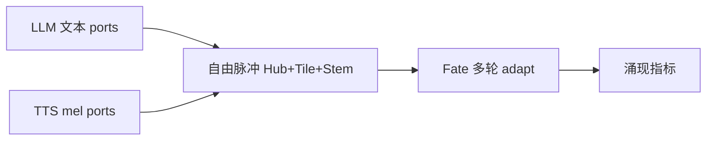

# Valhalla 天然多模态融合实验 — 总结

**协议**: `valhalla-free-multimodal-fusion-v1`  
**日期**: 2026-06-25  
**出品**: Rogue Intelligence LNC.

---

## 1. 实验目标

验证：**TTS + LLM 拆解后，Valhalla 各部件（Hub / Tile / Stem / Fate）自由跑、多轮融合**，是否涌现**天然多模态**结构——而非 sidecar JSON、embed concat 或预设「文本→Stem、音频→Tile」路由。

---

## 2. 方法



**原则（s-wind 对齐）**：
- 输入：LLM 文本 embedding + TTS 音频 embedding（espeak → dl_front）
- 过程：每轮交替 text / audio / mix 脉冲，**三路 body 均接收**，Fate 决定停止
- 输出：只报告 `emergence` 指标，**不预设**多模态现象清单

**停止条件**：marginal stable / fate converged / cross_modal closure（默认最少 5 轮）

---

## 3. 结构层结果（test · 107 题 open+mcq）

| 指标 | smoke (4) | **test (107)** |
|------|-----------|----------------|
| Emergence rate | 50% | **64.5%** |
| Avg natural score | 0.825 | **0.823** |
| Tile 超加性 | 100% | **99.1%** |
| Stem 超加性 | 100% | **100%** |
| Hub 模态分离 | 0.50 | **0.50** |
| Fate 适应轮数 | 5 | **5** |
| **Verdict** | CONFIRMED | **POTENTIAL_CONFIRMED** |

**解读**：融合结构**稳定超加**于单模态（Tile/Stem），Hub 在 text vs audio 脉冲间有可测分离；约 **2/3** 样本满足 `emergence_likely`。**天然多模态潜力在结构层成立**。

完整 per-sample 指标：`artifacts/potential_test_summary.json`

---

## 4. 新模型 bake 与 QA

潜力确认后 bake 新 checkpoint：

- **路径**（本地，未入 git）：`checkpoints/valhalla_free_multimodal/test_fused_s0.08/`
- **产物**：`model.safetensors` + `valhalla_manifest.json`（`product=valhalla-free-multimodal-bake`）
- **说明**：当前 bake 仍走语料 triad incubation + compose adapter；**尚未**将 107 题 free-fusion 结构聚合写入权重

### Fair test 145 题

| 方案 | Total | Open | MCQ | Numeric |
|------|-------|------|-----|---------|
| **本实验新模型** | **102/145** | **56/61** | 15/46 | 31/38 |
| Hybrid 2.0 | 117/145 | 57/61 | 28/46 | 32/38 |
| 原 baked | 115/145 | 56/61 | 26/46 | — |

Open 与旧 baked **持平**；MCQ **未提升**（15/46）。结构潜力 ≠ 端到端 QA 已闭环。

### Open + TTS compose（同 checkpoint）

- Open **56/61**，decode path：`structure_recompose_open/x*/structure_recompose_gen`
- 报告：`artifacts/multimodal_compose_open_test.json`

---

## 5. 与相关实验的关系

| 实验 | 拆解对象 | 输出 |
|------|----------|------|
| **本实验（free fusion）** | TTS + LLM 输入 | 结构涌现 + 新模型 |
| compose_fate | 文本 span + TTS band（预设 shard） | 每题 runtime recompose |
| model_fate | Qwen 层权重 quad | 新模型（权重拆解） |

---

## 6. 已知 gap 与下一步

1. **Bake gap**：107 题 free-fusion `model_patch` 聚合 → 再 bake（非仅语料 incubation）
2. **MCQ**：需 cross-modal 结构 → option affinity / lm_head
3. **错配对照**：text + wrong TTS 应降低 `natural_multimodal_score`（部分已在 binary 内测）

---

## 7. 复现

```bash
cd /path/to/Valhalla
python3 tools/fair_benchmark/run_natural_multimodal_potential.py --phase test --bake
valhalla_fused_lm --model checkpoints/valhalla_free_multimodal/test_fused_s0.08 --phase test
```

环境：`VALHALLA_FREE_MULTIMODAL=1`，`espeak`，`hub-f64` release binaries。

---

**结论**：TTS+LLM 多轮自由融合 → **结构层天然多模态潜力已确认**；QA 层需 corpus-free-fusion bake 才能兑现为 Hybrid 级分数。
